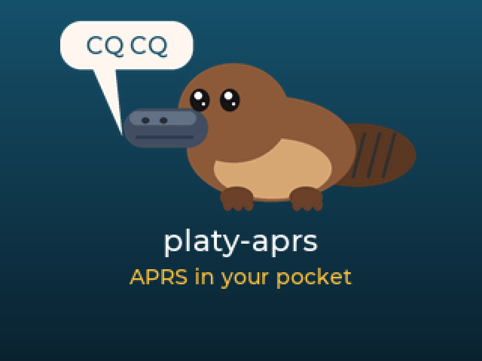

# platy-aprs

**APRS in your pocket.** Firmware that turns an ESP32-S3 handheld into a complete APRS station: it beacons your
position, sends and receives messages, lists and maps the stations around you, and can act as an iGate and
digipeater. It works over a Bluetooth KISS TNC (your handheld radio) or the board's own LoRa radio, and is
configured from the device or a built-in web page.

<p align="center"></p>

## Features

- **Two radio links:** a Bluetooth LE KISS TNC (BTECH/Vero VR-N76 and VR-N7600, Mobilinkd TNC3/TNC4, or any BLE
  KISS device), or the built-in LoRa radio running LoRa APRS.
- **Beaconing** from GPS with SmartBeaconing, at a fixed interval, or from a fixed position.
- **Messaging** with acks and retries, quick messages, favorites and new-message alerts (sound, a blinking light on the Mesh Deck, the keyboard backlight on the T-Deck Plus and T-LoRa Pager).
- **Stations, a live packet monitor and a map** with offline OpenStreetMap tiles and a heat map of activity.
- **APRS-IS client, iGate (RF → IS and IS → RF messages) and WIDE1-1 digipeater.**
- **Web interface** for every setting, plus messaging, monitoring and a JSON API.
- **Over-the-air updates**, signed and verified on the device before it switches to them.
- **Screen timeout** with pocket-safe wake buttons (or a double tap on touch screens), backups to file or SD card, and a packet log on SD.

## Supported boards

| Board | Radio | Input | Build env |
|---|---|---|---|
| Elecrow ThinkNode M9 | LR1110 | Keypad, d-pad | `m9` |
| Seeed Wio Tracker L2 | SX1262 | Touch, buttons | `wio-tracker-l2` |
| LilyGo T-Deck Plus | SX1262 | Keyboard, trackball, touch | `tdeck-plus` |
| Attaky Mesh Deck | SX1262 | Keyboard module, d-pad, touch | `mesh-deck` |
| Elecrow CrowPanel Advance 3.5 | SX1262 (expansion module) | Touch | `crowpanel-35` |
| LilyGo T-LoRa Pager | SX1262 | Keyboard, scroll wheel | `tlora-pager` |

The CrowPanel aside, all have GPS; on the CrowPanel it is an optional module on its UART connector, and it has no
battery. The Mesh Deck has no SD card slot, so it keeps no map tile cache, packet log or SD backups. The
T-Deck Plus and Mesh Deck builds are newer and less tested than the others, and the CrowPanel and T-LoRa Pager
builds have not been tested on hardware yet.

## Install

Download `platy-aprs-<board>-<version>.bin` for your board from [Releases](../../releases) and flash it at
`0x0`, any of these ways:

- In the browser with [esptool-js](https://espressif.github.io/esptool-js/) (Chrome or Edge): connect, add the file at address `0x0`, program.
- With the `flash.sh` attached to each release: `./flash.sh platy-aprs-<board>-<version>.bin /dev/ttyUSB0`
  (macOS: `/dev/cu.usbmodem*` or `/dev/cu.wchusbserial*`).
- With esptool: `esptool.py --chip esp32s3 write_flash 0x0 platy-aprs-<board>-<version>.bin`

After that, updates come over the air (**Settings → Firmware update**), and your settings are kept. The
`-ota.bin` images are the same firmware without the bootloader, for flashing at `0x10000` by hand.

## Quick start

1. Power on. The device opens a Wi-Fi network named `PLATY-APRS-XXXX` and shows a QR code to join it.
2. Join it and open `http://192.168.4.1`.
3. Enter your callsign on the **Station** tab, your Wi-Fi on the **Wi-Fi** tab, and save.
4. Pair your radio on the **Radio** tab (or switch to the built-in LoRa radio there).
5. Your position beacons once there is a GPS fix. Messages, stations and the map are on the device's home menu.

**[The user guide](docs/USAGE.md)** covers everything else: controls on each board, beaconing, messaging,
APRS-IS and iGating, the map, updates, backups, troubleshooting and the web API.

Transmitting on APRS frequencies requires an amateur radio licence.

## Building

You need [PlatformIO](https://platformio.org/install/cli).

```sh
scripts/build-upload-monitor.sh            # pick a board, build, flash, open the serial monitor
scripts/build-upload-monitor.sh -m -p /dev/cu.wchusbserial10   # a given board and port (-9 M9, -w Wio, -t T-Deck Plus, -m Mesh Deck, -3 CrowPanel, -l Pager)
scripts/build-upload-monitor.sh -B         # build every board and print a summary
pio test -e native                         # unit tests on the host
```

Other flags: `-e` erase the flash first, `-c` clean build, `-d` debug build, `-n` don't open the monitor.
Debug builds (`-DPLATY_SERIAL_KEYS`) accept key codes on the serial console and serve a raw RGB565 screen dump
at `/api/debug/screen` (`?splash=1` renders the splash screen).

Notes:

- **M9:** preproduction units' LR1110 radios run old firmware that rejects one RadioLib setup command;
  `tools/patch_radiolib_lr11x0.py` patches RadioLib at build time so `begin()` succeeds.
- **Mesh Deck:** it stays halted after a USB upload; power-cycle it to boot.
- **Splash art:** `python3 tools/gen_splash.py` regenerates `src/ui/splash_img.c` (`--png` writes a preview).

### Layout

| Path | |
|---|---|
| `src/aprs`, `src/ax25`, `src/kiss`, `src/util` | Packet encoding, parsing, iGate/digipeater rules (host-testable, no Arduino) |
| `src/hal` | Board support: pins, display, input, screen power, GPS, SD |
| `src/transport` | BLE KISS TNC and LoRa APRS links |
| `src/net` | Wi-Fi, APRS-IS client, web server and web UI |
| `src/services` | Beaconing, messaging, station store, routing, alerts, backups, packet log, OTA |
| `src/ui` | LVGL screens and the map |
| `test/` | Unity tests for the host-testable code |

## Releases

```sh
scripts/release.sh                             # help: every mode and option
scripts/release.sh --dist-only                 # build release images for every board into dist/, release nothing
scripts/release.sh --dist-only --only m9,mesh-deck --no-clean
scripts/release.sh --notes-only                # draft RELEASE_NOTES.md from the commits since the last tag
scripts/release.sh -y --use-committed-notes    # release: bump the patch version, dispatch the Release workflow
scripts/release.sh --release --version 0.2.0   # release an exact version
```

`dist/` holds, per board, `platy-aprs-<board>-vX.Y.Z.bin` (factory image), `-ota.bin` (app image) with its
`-ota.bin.sig` signature, and `.elf` (symbols), plus `flash.sh`, `BUILD-INFO.txt` and `SHA256SUMS`. A dist-only
build is versioned from `VERSION`, with `+<commit>` (and `.custom` for uncommitted changes) unless it is the
tagged release commit, and is signed only when `ota_signing_key.pem` is present.

A release ships only committed work on a branch in sync with origin. The script picks the version and dispatches
`.github/workflows/release.yml`, which runs in the `release` environment: it builds every board, signs the OTA
images with the `OTA_SIGNING_KEY` secret (after checking it matches `src/ota_signing_pubkey.h`), commits
`VERSION`, tags `v<version>`, publishes the images, and keeps the `.elf` files as a workflow artifact.
`--build-local` does the same on your machine. `.github/workflows/build.yml` builds every board from a clean
checkout on each push and pull request, runs the unit tests and checks flash headroom; it publishes nothing.

### Over-the-air updates

Devices fetch updates over plain HTTP from `http://ota.platy.sumat.org/firmware`, a proxy for this repo's GitHub
releases (`/latest`, then `/<tag>/platy-aprs-<board>-<tag>-ota.bin` and its `.sig`). The image is hashed as it
downloads, and its ECDSA P-256 signature is checked against the public key compiled into the firmware before the
new image is made bootable, so a tampered or corrupt download is never run. The private key
(`ota_signing_key.pem`) is git-ignored and must never be lost: devices accept updates signed with it alone.

## License

GPL-3.0-or-later; see [LICENSE](LICENSE). Board pin maps, bring-up sequences and the OTA design follow
camillia-mt, and the Mesh Deck keyboard layout comes from the [wadamesh](https://github.com/ALLFATHER-BV/wadamesh)
MeshCore port; both are GPL-3.0-or-later. Map data © OpenStreetMap contributors.
