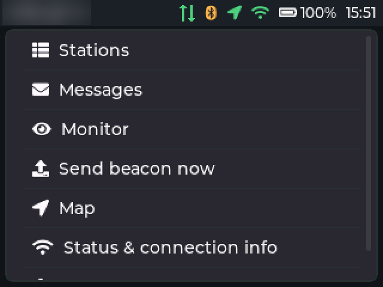
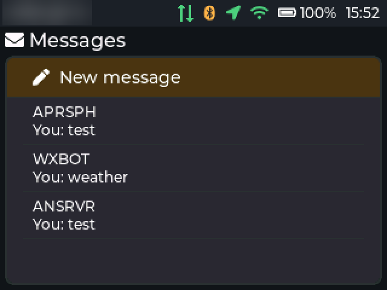
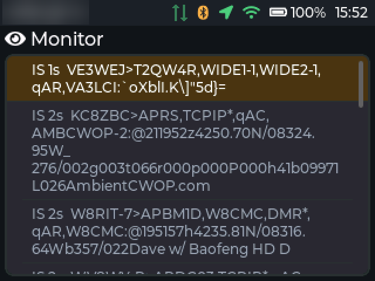

# Using Platy APRS

This guide covers everything you do with a Platy APRS device once it is flashed: first setup, the screens, the
controls on each board, the radio links, beaconing and messaging, APRS-IS, the map, updates and backups. For
installing the firmware see the [README](../README.md#install).

You need an amateur radio licence to transmit on APRS frequencies. Receiving needs none.

- [First-time setup](#first-time-setup)
- [Getting around](#getting-around)
- [Controls by board](#controls-by-board)
- [Connecting a radio](#connecting-a-radio)
- [Your station and beaconing](#your-station-and-beaconing)
- [Messages](#messages)
- [Stations, Monitor and Map](#stations-monitor-and-map)
- [APRS-IS, iGate and digipeater](#aprs-is-igate-and-digipeater)
- [Sound](#sound)
- [Screen timeout](#screen-timeout)
- [Firmware updates](#firmware-updates)
- [Backup, restore and the packet log](#backup-restore-and-the-packet-log)
- [The web interface](#the-web-interface)
- [Troubleshooting](#troubleshooting)
- [Web API](#web-api)

## First-time setup

1. **Power on.** The splash screen shows for a moment, then the home menu.
2. **Restore, if you have a backup.** On a device with no settings (new, or just erased) that finds backups on
   its SD card in `/platy/backups`, it first asks whether to restore one (the device reboots with those
   settings) or start fresh.
3. **Join the setup network.** With no Wi-Fi configured the device opens an open access point named
   `PLATY-APRS-XXXX`, and pops up **Status & connection info** with its name and a QR code to join it. Join it
   from your phone or computer.
4. **Open the web interface** at `http://192.168.4.1`. (There is no captive portal; type the address.)
5. **Set your station.** On the **Station** tab enter your callsign and SSID, then **Save**.
6. **Join your Wi-Fi.** On the **Wi-Fi** tab enter your network and password and save. Or do it on the device:
   **Settings → Wi-Fi** scans; pick a network and type its password (**Other network...** for a
   hidden one).
7. **Reconnect.** Once the device is on your network the setup AP shuts down after about 15 s. Rejoin your
   own network and open `http://platy-aprs.local` or `http://<device-ip>` (shown under **Status & connection
   info**).
8. **Connect a radio** (see [Connecting a radio](#connecting-a-radio)).

If your network is out of reach for 60 s the setup AP comes back on its own. You can also open it from
**Settings → Wi-Fi → Open setup access point** while the device is not connected. It never stays up once the
device is on a network.

**Wi-Fi: On/Off** at the top of **Settings → Wi-Fi** turns Wi-Fi off entirely: no network, no setup AP, and so
no web interface or APRS-IS until you turn it back on there. It's only on the device, so the web page can't lock
itself out.

**Secure the web interface.** Anyone on the same network can open it. Set an admin password on the
**Device** tab (the username is `admin`).

## Getting around

<p align="center"></p>

The home screen is a grid of buttons, two to a row (where **Send beacon now** and **Status & connection info**
don't fit on one line, as on 320-wide screens or with large text, they read **Beacon** and **Status**). On the CrowPanels there is no **Status & connection info** button:
the same information, and the setup AP's QR code while it is on, stays on the left of the home screen with the
buttons on the right. The **status bar** across the top of every screen shows your callsign, unread
messages, the radio link (Bluetooth TNC or LoRa) and APRS-IS (each blinks on traffic), GPS, Wi-Fi, battery and
the time.

| Item | What it does |
|---|---|
| **Stations** | Every station heard, newest first, favorites on top. Open one for its details. |
| **Messages** | Conversations; start a new one or continue one. |
| **Monitor** | The raw packet feed, as heard and sent. |
| **Send beacon now** | Sends your position straight away. |
| **Map** | Heard stations on an OpenStreetMap map. |
| **Status & connection info** | Wi-Fi, IP address, setup AP and its QR code, radio link status. |
| **Settings** | Everything else (below). |

**Settings** holds: Wi-Fi (on/off, networks, setup access point) · Quick messages · GPS & beacon (send a beacon,
turn the GPS on or off) · Connections (APRS-IS, TNC, LoRa; see below) · Screen timeout · At timeout · Brightness (opens a slider: Left/Right or drag it; not on the T-Deck Pro) · Sound and Volume
(see [Sound](#sound)) · Message light (Mesh Deck) or Keyboard blink (T-Deck Plus, T-LoRa Pager, T-Deck Pro), and Light timeout (see [Message light](#message-light)) · Theme (dark or light, applies at once; not on the T-Deck Pro) · Accent color (the button colour: pick Orange, Red, Pink, Purple, Blue, Cyan, Teal, Green, Yellow or Grey from a pop-up of swatches; button text turns light or dark to suit; the web Device tab also takes any hex colour, with your choice of light or dark text; not on the T-Deck Pro) · Text size (Small, Medium, Large or X-Large from a pop-up; also on the web Device tab) · Orientation (CrowPanels and Wio Tracker L2: pick Landscape, Landscape 180, Portrait or Portrait 180 from a pop-up; also on the web Device tab) · Backup settings to SD card ·
Firmware update · About · Reboot. On the T-Deck Pro, Settings uses shorter names.

The status bar along the top shows your callsign, an unread-message marker, the radio link (Bluetooth icon, or
`LoRa`), GPS (green with a fix, amber while searching), Wi-Fi (`AP` while the setup network is on), battery and
the time, plus a back arrow on touch screens when you are deeper than the home screen.

## Controls by board

### Elecrow ThinkNode M9

| Key | Action |
|---|---|
| D-pad | Move; centre selects |
| Back | Previous screen / close |
| Home | Home screen |
| Button below Home | Monitor |
| Button below Back | Stations |
| Messages | Messages |
| Map | Map |
| Keyboard | Typing |

### LilyGo T-Deck Plus

The keyboard types; the trackball moves, and a click selects (sent when you let go). There is no Back key:
**Backspace** outside a text field goes back. **Alt+F** stars or unstars the selected conversation. The
touch screen works everywhere.

### Seeed Wio Tracker L2

Touch the screen to use it; text fields bring up an on-screen keyboard. The **BOOT** button goes back (hold it
for the home screen). The top **Wake** button turns the screen off and on (see
[Screen timeout](#screen-timeout)).

### Attaky Mesh Deck

The keyboard module types, the d-pad moves, **Select** confirms (hold it to go back), and the touch screen works
everywhere. There is no on-screen keyboard on this board.

| Keys | Gives |
|---|---|
| Letters, digits, `,` `.`, Space | As labelled |
| **Shift** + letter / digit | Capital / `! @ # $ % ^ & * ( )` |
| **Sym** + `q w e r t y u i o p` | `? / - _ = + [ ] { }` |
| **Sym** + `a s d f g h j k l` | `` : ; ' " ` ~ \ \| & `` |
| **Sym** + `z x c v b n m` `,` `.` | `< > * @ # % ^` `!` `?` |
| **Tab** | Next field |
| **Alt** + H / M / P / S / L | Home / Messages / Map / Stations / Monitor |
| **Alt** + Backspace | Back |
| **Alt** + F | Star / unstar the selected conversation (or the open conversation or station) |

### Elecrow CrowPanel Advance 3.5

Touch only: tap to use it, and text fields bring up an on-screen keyboard. The back arrow at the left of the
status bar goes back (hold it for the home screen). The board has no free button, so a **double tap** wakes the
screen from the screensaver and from off (see [Screen timeout](#screen-timeout)). The screen is 480×320, and
the LoRa module goes in the J8/J9 expansion slot. It has no battery, so the status bar shows no battery
indicator. GPS is optional: a module on the UART1 connector is picked up when present.

### Elecrow CrowPanel Advance 5.0

Used like the 3.5: touch only, with an on-screen keyboard, the status-bar back arrow, and a **double tap** to
wake. The screen is 800×480. The LoRa module goes in the J8/J9 wireless slot, and the **function DIP switch on
the back must select the wireless module** (S1 off, S0 on); otherwise the radio isn't found. That switch gives
the SD card's pins to the radio, so there is no SD card, and the board has no GPS (set a fixed position for
beacons) and no battery. The build is for V1.2 and later boards; a V1.0 board needs a build with
`-DCROWPANEL_50_HW_V10=1`, as its radio select is on another pin.

### LilyGo T-LoRa Pager

There is no touch screen: the scroll wheel steps through the controls in order (and changes the value of a
slider or list being edited). It scrolls long text too: a box of details scrolls before the wheel moves past
it, and at the first or last control the screen scrolls to anything beyond it. A click selects (sent when you let go). **Backspace** outside a text field
goes back. The screen is 480×222.

| Keys | Gives |
|---|---|
| Letters, Space, Enter | As labelled |
| **Shift**, then a letter | Capital |
| **Sym**, then `q`…`p` | `1`…`0` |
| **Sym**, then `a s d f g h j k l` | `* / + - = : ' " @` |
| **Sym**, then `z x c v b n m` | `_ $ ; ? ! , .` |
| **Sym** + Enter | Next field |
| **Sym** + Backspace | Back |
| **Sym** + Space | Home screen |
| **Sym** + F (outside a text field) | Star / unstar the selected conversation |

Shift and Sym apply to the next key only, and lapse after 1.5 seconds.

### LilyGo T-Deck Pro

The screen is a 240×320 black-and-white e-paper panel with a frontlight, and takes touch; the keyboard types
and moves around. There is no on-screen keyboard. The UI is always light (no dark theme), nothing animates, and
the panel redraws only when something on it changes, with a full (flashing) refresh every so often to clear
ghosting. The frontlight stays off, so there is no brightness setting. The screen doesn't
rotate, and the board has no sound.

| Keys | Gives |
|---|---|
| Letters, Space, Enter, Backspace | As labelled (Backspace outside a text field goes back) |
| **Shift**, then a letter | Capital |
| **Sym**, then a key | The symbol printed on it |
| **Sym** + Enter | Next field |
| **Sym** + Backspace | Back |
| **Sym** + Space | Home screen |
| **Alt** + W / A / S / D | Up / Left / Down / Right |
| **Alt** + Enter | Next field |
| **Alt** + H / M / P / T / L | Home / Messages / Map / Stations / Monitor |
| **Alt** + Backspace | Back |
| **Alt** + F | Star / unstar the selected conversation (or the open conversation or station) |

Shift and Sym apply to the next key only, and lapse after 1.5 seconds. Alt works held down, or tapped for the
next key.

## Connecting a radio

The device talks APRS through one RF link at a time: a **Bluetooth KISS TNC** (an external radio or TNC) or the
board's **built-in LoRa radio**, or neither. **Settings → Connections** lists APRS-IS, TNC and LoRa,
each with an on/off switch; turning the TNC or LoRa on turns the other off. Pick a connection's name to open its
settings. The web **Radio** tab has the same choice. The status bar shows which is in use.

### Bluetooth KISS TNC

Works with the BTECH/Vero VR-N76 and VR-N7600, Mobilinkd TNC3/TNC4, and any BLE device that speaks KISS.

1. Put the radio in Bluetooth pairing mode.
2. Web **Radio** tab → **Scan**, or **Settings → Connections → TNC** on the device. Devices offering the
   KISS service are marked `[KISS]`.
3. Pick your radio and the device connects. Tick **Reconnect automatically** (off by default) to have it connect
   at startup and reconnect when the link drops.

The defaults match the common BLE KISS service (`00000001-ba2a-46c9-ae49-01b0961f68bb`); other UUIDs can be
set on the Radio tab.

**Receive works but sending fails?** The pairing keys no longer match (typical after erasing either side).
Delete the pairing with **Remove** under **Settings → Connections → TNC** (or **Paired radios** on the web Radio tab), remove the
device from the radio's Bluetooth list too, and connect again.

### LoRa APRS

The defaults follow the usual LoRa APRS convention, so the device works with LoRa APRS iGates and trackers
straight away: 433.775 MHz, SF12, 125 kHz, CR 4/5, 20 dBm. Frequency (150–960 MHz), spreading factor,
bandwidth, coding rate and power can be changed on the Radio tab. On the device, **Settings → Connections →
LoRa** shows the link's status, steps the TX power, and offers to go back to the standard settings if they were
changed. Each board's antenna and RF path are built for
the band it was sold for; stay in that band.

## Your station and beaconing

**Station tab:** callsign and SSID (default `-9`), the APRS symbol (table and code; default `/>` car), a
comment, and the digipeater path (default `WIDE1-1,WIDE2-1`).

**Beacon tab:** where your position comes from:

- **GPS**, with **SmartBeaconing** (default): beacons more often when moving fast or turning, rarely when
  parked. The slow/fast rates and speeds and the turn settings are adjustable.
- **GPS** at a fixed interval (SmartBeaconing off).
- **Fixed position**: a latitude, longitude and altitude you enter, beaconed at the interval.
- **Off**.

In GPS mode, if the GPS is turned off or not responding (no module fitted), the beacon uses the fixed position instead, when one is set. A working GPS that is still waiting for a fix keeps waiting.

Beacons go out once a callsign is set and the radio link (or APRS-IS) is up. **Send beacon now** is on the home
screen, under **Settings → GPS & beacon**, and on the Beacon tab. To avoid flooding the channel, no beacon
(automatic, SmartBeaconing corner or sent by hand) goes out within 30 seconds of the last one. The GPS can be switched off entirely under
**Settings → GPS & beacon** to save power. With no network time, the GPS sets the clock.

## Messages

<p align="center"></p>

Open **Messages** on the device (or the Messages key/hotkey, or the web **Messages** tab) and pick a
conversation or start a **New message** to a callsign.

- Outgoing messages are retried up to 5 times (after 30 s, 1, 2 and 4 min) until the other station acks them;
  a message that was never acked can be retried by hand (select it).
- Incoming messages are acked, de-duplicated, beep, and pop up a banner.
- Select any other message for its details: when it was sent or received, and for incoming ones how it
  arrived (APRS-IS, or RF through the Bluetooth TNC or LoRa), the path, whether it was digipeated, which igate
  or server it came through, and its message ID. Messages saved before this was added show "unknown".
- The list button next to the message box opens your five **quick messages**; picking one fills it in. It
  sits left of the box on touch screens and right of it on the M9, where pressing **Right** with the cursor at
  the end of your text moves to it. Edit them under **Settings → Quick messages** or on the web **Station** tab.
- Star a conversation to keep it at the top (**Alt+F** on the T-Deck and Mesh Deck keyboards, **Sym+F** on the Pager).
- **Mark all as read** and **Delete all messages** sit above New message; deleting asks first and keeps starred
  conversations unless you select **Include starred conversations**.
- Long-press a conversation for **Mark as read** or **Delete**. With keys, focus it and press **Right**
  (**Space** on the Pager).

Conversations are stored on the SD card (`/platy/messages.json`).

## Stations, Monitor and Map

**Stations** lists everyone heard, newest first. Open a station for its details: position, distance and
bearing from you (when you both have a position), course and speed, comment, path, and when it was heard. Star a station to keep it at the top; favorites are never dropped when the list is full.

**Monitor** shows every packet as it arrives or leaves, decoded where possible. Each line starts with **TX**
for packets you sent (in blue) or **IS** for ones from APRS-IS (in grey), then how long ago; RF lines have no
tag. **Clear** (beside the title, and on the web **Monitor** tab) empties the feed on both; packet logs on the SD
card are kept.

<p align="center"></p>

**Map** draws stations over OpenStreetMap: amber for heard on RF, grey for APRS-IS, blue for weather, purple for
objects, and you in blue. Underneath, a heat map of every heard station shows busy areas when zoomed out.
Tiles download when the device is on Wi-Fi and are cached on the SD card (`/platy/tiles`), so places you have
looked at work offline.

| Map control | Keyboard boards | Touch |
|---|---|---|
| Pan | D-pad / arrows / trackball | Drag |
| Zoom | `+` or `i` in, `-` or `o` out | Zoom buttons |
| Next station in view | `N` | Tap a station |
| Centre on me | `C` | Centre button |
| Station details | Enter | Tap the selected station again |

## APRS-IS, iGate and digipeater

APRS-IS is switched on and off under **Settings → Connections** on the device; **APRS-IS** there sets the
server, port, filter and passcode. Everything else is on the web **APRS-IS** tab:

- **Connect to APRS-IS when on Wi-Fi**: logs in to `rotate.aprs2.net` (changeable) with the passcode computed
  from your callsign, receives the packets your filter selects (default `m/50`: everything within 50 km), and
  sends your beacons and messages to APRS-IS as well as over RF. Messaging then works even without a radio or a
  nearby iGate.
- **iGate: gate RF packets to APRS-IS** (on by default once connected): packets heard on RF are passed to
  APRS-IS as `qAR,<your call>`. NOGATE, RFONLY, TCPIP and TCPXX paths, queries, and third-party packets that
  came from the Internet are not gated.
- **iGate: gate APRS-IS messages to RF** (off by default): a message from APRS-IS for a station heard directly
  on RF in the last 30 minutes, from a sender not on RF, is transmitted as third-party traffic.
- **Digipeater** (off by default): WIDE1-1 fill-in and packets routed through your callsign, with 30 s
  duplicate suppression.

## Sound

Alerts sound for new messages, acks, failed sends and beacons, and once at boot. **Settings → Sound** steps
through the new-message tone styles **Default**, **Chirpy** and **Bass**, playing each, and **Off**, which
silences every alert. On the T-Deck Plus, Wio Tracker L2 and T-LoRa Pager (speakers), **Settings → Volume** steps from 0 to
100% in tens; 50% is the normal level. The M9's buzzer has no volume control, and the Mesh Deck, CrowPanels and T-Deck Pro have no sound.
Both are also on the web **Device** tab.

## Message light

The Mesh Deck's RGB lights (the one on the front and one on each keyboard half) double-blink once a second
when a message arrives, even with the sound off. **Settings → Message light** steps through **Red**, **Green**,
**Blue** (the default), **Yellow**, **Cyan**, **Magenta**, **White** and **Off**, blinking each.
**Settings → Light timeout** sets how long the blinking lasts after the newest message: 5, 10, 15 (the default) or
30 seconds, 1, 2 or 5 minutes, or **Never** (until the messages are read). Reading the messages stops it
sooner. Both are also on the web **Device** tab.

On the T-Deck Plus, T-LoRa Pager and T-Deck Pro the keyboard backlight blinks the same way, but only while the screen is off or showing the
screensaver; turning the screen on stops it. **Settings → Keyboard blink** turns it on (the default) or off, and
**Light timeout** works as above. The T-Deck keyboard needs its 2024-12-25 or later firmware; older keyboards ignore it.
The other boards have no such light.

## Screen timeout

After the screen timeout with no input, the backlight dims for the last 10 seconds and then the screen locks:
either the **screensaver** (the platy drifting around a dark screen at 20% backlight) or **screen off**. Set the
timeout under **Settings → Screen timeout** (each press steps to the next choice) and the choice under
**Settings → At timeout**, or both on the web **Device** tab. The timeout runs 15 s to 60 min, or Never; the
default is 30 s with the screensaver.

While the screen is locked, key presses and touches are ignored rather than acted on unseen, and only the board's
wake gesture unlocks it. For 3 seconds after it locks nothing can unlock it, so the press that locked it can't
undo itself.

A **screen button** works the same way on every board: **tap** to turn the screen off (from the screensaver too),
**hold for 2 seconds** to unlock. A tap on a dark screen brings up the screensaver for a look, which goes back
off after the screen timeout (30 s if the timeout is Never); a press in a pocket can't get past it.

On a touch screen, a **double tap** on the screensaver also unlocks it: two quick taps in the same spot. A dark
screen ignores touch, except on the CrowPanels, which have no screen button and takes the double tap there too.

| Board | Screen off | Unlock | Doesn't unlock it |
|---|---|---|---|
| ThinkNode M9 | Hold the d-pad centre, or tap BOOT | Press the d-pad centre, or hold BOOT | Any other key |
| Wio Tracker L2 | Tap the top Wake button | Hold Wake, press BOOT, or double-tap the screensaver | Other touches |
| T-Deck Plus | Hold the trackball click for 2 s | Click the trackball, or double-tap the screensaver | Keyboard, other touches, rolling the ball |
| Mesh Deck | Tap the top-right (R) shoulder button, or BOOT | Hold R or BOOT, or double-tap the screensaver | Keyboard, d-pad, other touches |
| CrowPanel 3.5 / 5.0 | Only at the timeout | Double-tap the screen | Other touches |
| T-LoRa Pager | Tap BOOT, or hold the wheel click for 2 s | Hold BOOT, or click the wheel | Keyboard, turning the wheel |
| T-Deck Pro | Tap the side button | Hold the side button, or double-tap the screensaver | Keyboard, other touches |

On the T-Deck Pro's e-paper the screensaver is a still picture rather than the drifting platy, and "screen off"
turns off the frontlight and stops redrawing; the panel keeps showing its last image.

## Firmware updates

**Settings → Firmware update** on the device, or the **Firmware update** card on the web **Device** tab, shows
the running version, checks for a newer release and installs it. The device also checks by itself 20 seconds
after joining Wi-Fi, then once a day. Turn on **Install updates automatically** to have it install new releases
on its own (off by default).

Installing downloads the new firmware in the background, checks its signature, then reboots into it. Your
settings, messages and stations are kept. An image whose signature doesn't check out is never booted, and a
failed or interrupted install leaves the running firmware untouched.

Updates need the flash layout Platy APRS ships with. A device installed some other way (for example by a
multi-firmware installer) is not offered updates; reflash the factory image over USB once.

## Backup, restore and the packet log

**Backups** (web **Device** tab): download a backup file, restore one by uploading it, or save backups to the SD
card (`/platy/backups`) and restore, download or delete them there. Wi-Fi and admin passwords are only included
if you tick the box; when restoring a backup without them, the current passwords are kept. Restoring reboots
the device. **Settings → Backup settings to SD card** saves one from the device (without passwords).

**Packet log**: with **Log packets to the SD card** on (the default), every packet heard on RF and everything
sent is appended to `/platy/logs/YYYY-MM-DD.log` (UTC dates; `nodate.log` until the clock is set), one line each:

```
2026-10-12 21:54:03Z RF< N0CALL-9>APRS,WIDE1-1:!4903.50N/07201.75W>
```

`RF<` heard, `RF>` sent, `IS<`/`IS>` APRS-IS (only logged with **Also log packets received from APRS-IS** on).
Logs can be downloaded or deleted on the Device tab.

The Mesh Deck has no SD card slot, and the CrowPanel 5.0 gives the card's pins to the radio, so neither keeps a
packet log, map tiles or SD backups. On the CrowPanel 3.5 the
card is read over a slower software SPI link; it still does all of the above.

## The web interface

Open `http://platy-aprs.local`, the device's IP address, or `http://192.168.4.1` on the setup network.

| Tab | Contents |
|---|---|
| **Station** | Callsign, SSID, symbol, comment, path, quick messages |
| **Beacon** | Position source, fixed position, interval, SmartBeaconing, GPS power |
| **Radio** | RF link (Bluetooth TNC or LoRa), TNC scan and pairing, UUIDs, LoRa settings |
| **APRS-IS** | Connection, server, passcode, filter, iGate and digipeater |
| **Wi-Fi** | Network, password, hostname |
| **Device** | Units, alert sound and volume, message light (Mesh Deck) or keyboard blink (T-Deck Plus, T-LoRa Pager, T-Deck Pro) and its timeout, brightness (not on the T-Deck Pro), screen timeout and screensaver, theme (dark/light; not on the T-Deck Pro), accent color (presets or a custom hex code with light or dark button text; not on the T-Deck Pro), timezone, admin password, firmware update, backups, packet logs, reboot, factory reset |
| **Monitor** | Live packet feed |
| **Stations** | Heard stations, favorites |
| **Messages** | Conversations; send messages |

Settings on every tab are saved together with the **Save** button in the bar pinned to the bottom of the page.
The bar says when there are unsaved changes, and the browser asks before you leave the page with any.

## Troubleshooting

| Problem | Try |
|---|---|
| Can't find the setup network | It only runs while the device has no working Wi-Fi. Open it from **Settings → Wi-Fi → Open setup access point** (Wi-Fi must be on), or wait 60 s after the configured network goes away. |
| `platy-aprs.local` doesn't open | Use the IP address shown under **Status & connection info**; some networks block mDNS. |
| Beacons don't go out | A callsign must be set (not `N0CALL`) and the radio link up; with GPS as the source, wait for a fix. |
| TNC receives but can't send | Delete the pairing on both sides and pair again (see [Bluetooth KISS TNC](#bluetooth-kiss-tnc)). |
| Messages are never acked | The other station may be out of range or not running messaging; with APRS-IS on, messages also go over the Internet. |
| The map stays blank | Tiles need Wi-Fi the first time an area is viewed (and an SD card to cache them). |
| The screen won't come back on | Use the board's wake gesture ([Screen timeout](#screen-timeout)); touch and the keyboard don't wake it. |
| "Updates unavailable on this flash layout" | Reflash the factory image over USB once. |
| The Mesh Deck stays dark after flashing | It stays halted after a USB upload; power-cycle it. |

## Web API

Every endpoint the web interface uses is available to scripts. Responses are JSON. Every `POST` must carry an
`X-Platy: 1` header (a guard against cross-site requests), and when an admin password is set every request needs
HTTP Basic auth as `admin`.

```sh
curl http://platy-aprs.local/api/status
curl -X POST -H 'X-Platy: 1' -H 'Content-Type: application/json' \
     -d '{"to":"N0CALL-9","text":"hello"}' http://platy-aprs.local/api/messages
```

| Endpoint | |
|---|---|
| `GET /api/status` | Wi-Fi, radio link, GPS, beacon and APRS-IS status |
| `GET` / `POST /api/config` | Read / change settings (passwords are never returned) |
| `GET /api/wifi/scan[?start=1]` | Wi-Fi scan results |
| `GET /api/tnc/status` · `GET /api/tnc/scan[?start=1]` | TNC status · Bluetooth scan |
| `POST /api/tnc/select` · `connect` · `disconnect` | Choose / connect / disconnect the TNC |
| `GET /api/tnc/bonds` · `POST /api/tnc/forget` | Paired radios · delete pairings |
| `GET /api/packets?since=N` | Packet feed |
| `GET /api/stations` | Heard stations |
| `POST /api/beacon` | Send a beacon now |
| `GET /api/messages[?peer=]` · `POST /api/messages` (`{to,text}`) | Conversations · send |
| `POST /api/messages/read?peer=` · `delete?peer=` · `retry?seq=` | Mark read · delete · retry |
| `POST /api/favorites/toggle?call=` | Star / unstar |
| `GET /api/ota` · `POST /api/ota/check` · `POST /api/ota/install` | Firmware update status · check · install |
| `GET /api/backup[?secrets=1]` · `POST /api/restore` | Download / restore a backup |
| `GET` / `POST /api/backup/sd` · `POST /api/backup/sd/restore?name=` · `GET /api/backup/sd/download?name=` · `POST /api/backup/sd/delete?name=` | SD backups |
| `GET /api/logs` · `GET /api/logs/download?name=` · `POST /api/logs/delete?name=` | Packet logs |
| `POST /api/reboot` · `POST /api/factory-reset` | Reboot · erase settings and reboot |
